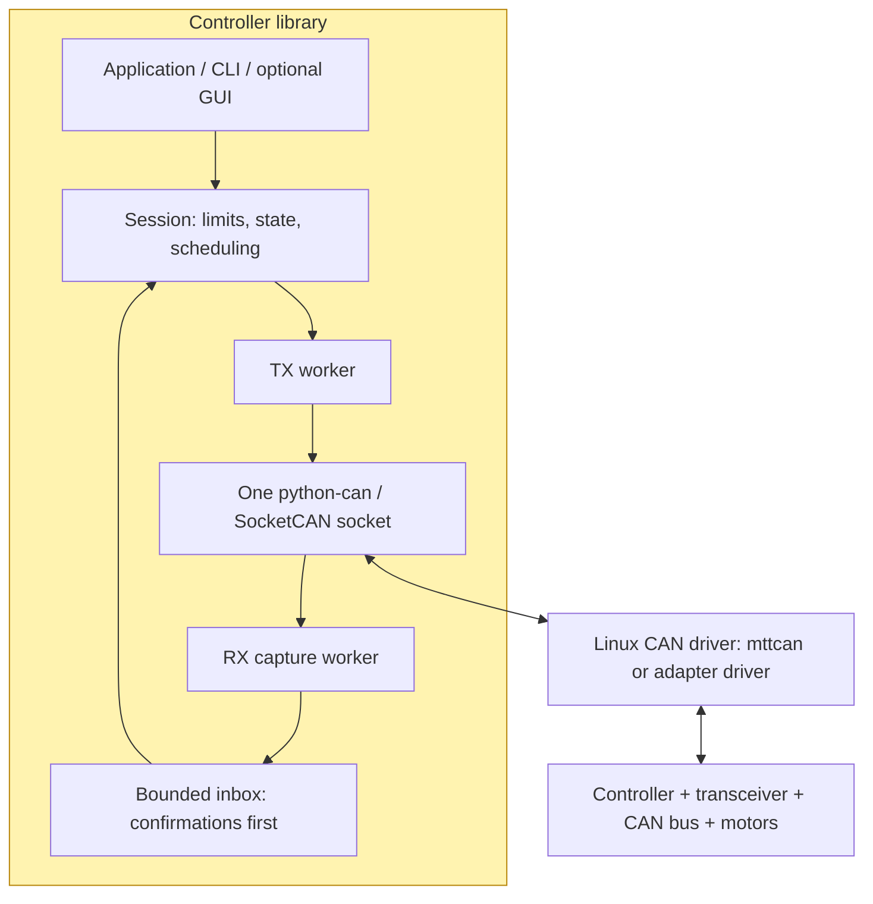

# HandyCAN

**Experimental / beta motor-control software.** Read [hardware safety](SAFETY.md),
[contribution instructions](CONTRIBUTING.md), and [security reporting](SECURITY.md).
Licensed under [MIT](LICENSE); dependency licenses remain separate.

A Linux controller for **CubeMars AK70-10 V2 and AK80-6 V2 in MIT mode**, using
**python-can + Linux SocketCAN, classic CAN at 1 Mbps**.

**Communication: sequential verified startup, then asynchronous transmit/receive.**
One persistent SocketCAN socket is shared by a TX scheduling thread and a sole RX
thread. This is threaded asynchronous I/O, not an asyncio API. Normal commands do
not wait for each motor reply; per-motor feedback freshness and driver TX
confirmations are supervised independently. CAN frames still serialize on the bus.
Python/Linux timing is best effort; a configured 1000 Hz is not a guarantee.



## Start here

- [Jetson Orin Nano setup and recovery](docs/jetson.md), including `./Recover_can`.
- [Raspberry Pi 5 setup](docs/raspberry-pi-5.md).
- [Configuration examples and units](examples/README.md).
- [Every controller source file: purpose, edit points, and verification](src/handycan/README.md).
- [Setup/recovery scripts](tools/README.md) and [offline tests](tests/README.md).
- [Validation and known limitations](VALIDATION.md).

`main` contains the controller and continuous target streaming API.
The [`gui-without-continuous-api` branch](https://github.com/Anirudh-singh-Core/Cubemars_SocketCAN_Control/tree/gui-without-continuous-api)
adds the browser GUI; its UI does not expose continuous target streaming.

No GUI, simulator runtime, automatic filter selection, shell startup hooks,
background boot installation, implicit motor enable, or automatic reconnect.
Importing the library sends nothing. `Session.open()` validates and opens CAN but
sends nothing. Hardware activation always requires an explicit API call or
`--active` in the CLI.

## Structure

| Module | Responsibility |
| --- | --- |
| `interface.py` | Read-only interface status and readiness checks |
| `transport.py` | Cooperative channel lease and persistent `python-can.Bus` |
| `receive.py` | Bounded RX handoff and socket-drain checkpoints; no session lock in capture |
| `pipeline.py` | Per-ID exchanges, serialized startup, TX confirmation, bounded disable transitions |
| `protocol.py` | Pure MIT encoding/decoding, including feedback identity checks |
| `session.py` | Separate TX/RX workers, transmission schedule, motor states, stop/health supervision |
| `limits.py`, `motion.py` | Caller-defined limits and elapsed-time quintic profiles |
| `streaming.py` | Immutable degree-based joint target samples for external planners |
| `diagnostics.py` | CAN test through the existing session, with per-phase error evidence |
| `filters.py` | Existing low-pass, Adaptive EMA, and scalar Kalman math |
| `journal.py` | Bounded asynchronous JSONL history; disk I/O outside the CAN worker |
| `cli.py` | Explicit status, test, and monitoring commands |

One RX worker reads the bus and routes feedback by CAN ID. A separate TX worker
schedules all motor commands on that same socket. CAN Test borrows the session; it never opens a second bus.
An operation lock excludes diagnostics from public enable/move/zero operations.
Stop bypasses that lock and the normal command queue. No `Notifier` is used:
the RX worker is the sole receive consumer, preventing competing readers.

A same-user channel lock is acquired once per session, at
`~/.cache/handyflie/can0.lock`, compatible with the previous beta's lock. It is
cooperative: `cansend`, old standalone scripts, and other Linux users can bypass
it. Never run another command sender at the same time. `candump` can observe.

## Install

Python 3.10+ on Linux; the tested dependency is python-can 4.6.1.
From this directory:

```bash
python3 -m venv .venv
.venv/bin/python -m pip install -e '.[test]'
```

If your OS lacks `venv`/`ensurepip`, install its Python venv package first.
Use the virtual environment interpreter for all commands; no global `can` alias
or system Python replacement is installed.

For Raspberry Pi 5, follow the [hardware and setup guide](docs/raspberry-pi-5.md).
An existing physical SocketCAN interface on either board can be configured with
`sudo bash tools/setup_socketcan.sh --confirm-stopped can0`. Without the Jetson flag, this does not install
a hardware driver or change pinmux.

## Explicit CAN setup after boot

For the verified **Jetson Orin Nano / J17** wiring in this project only:

```bash
sudo bash tools/setup_socketcan.sh --confirm-stopped --jetson-orin-nano can0
```

This checks the board model, acquires the channel lease, loads the modules,
configures the known pin registers, and brings can0 up at 1 Mbps. No motor frame
is sent. It is manual; never run it during control. A healthy interface already matching
these settings is left untouched. Setup explicitly disables loopback, listen-only,
one-shot, CAN FD, and automatic bus-off restart, and enables error reporting.
Normal setup does not reload the driver or reset an unhealthy controller. Other boards
need their own validated pinmux configuration. Opening a terminal does not run setup.

Configure **all motors before Connect**. Connect opens one socket for the entire
configuration without sending frames; enabling motor 1 first is unnecessary.
To change the motor list, disable/disconnect, edit/apply configuration, and connect
again. That replaces only the Session/socket; it does not reinitialize Linux CAN.
A fault stops control and remains visible. Do not make a bus reset or first-motor
priming sequence part of ordinary startup. The physical cause of the intermittent
multi-motor bit errors has not been established by offline tests.

## Status, communication test, monitor

Commands are shown from this directory with `.venv/bin/python`; substitute your
environment's Python. All public commands support `-h`, `-help`, and `--help`.

```bash
.venv/bin/python -m handycan status --channel can0
.venv/bin/python -m handycan test --config examples/motor.json --id 1
```

The default test is receive-only and fails if it cannot observe existing matching
external feedback. It does not poll a disabled motor.

**Review the sample motor limits for your mechanism before active use.** The
numbers in `examples/motor.json` are examples, not established safe limits.

```bash
.venv/bin/python -m handycan test --config examples/motor.json --id 1 --active
.venv/bin/python -m handycan monitor --config examples/motor.json --id 1 --active --seconds 10
```

Both active commands enable the motor with zero gains and nominal zero torque.
That releases holding and has MIT quantization residuals; support the mechanism.
They attempt disable on completion/exception/Ctrl+C. The monitor prints at 20 Hz;
CAN polling targets the configured control rate (1000 Hz in the example).

The test prints only Pass/Fail. Details overwrite `logs/can_test_latest.json`;
the session history logs every phase. A test does not grant permanent proof of
health and is not a mandatory stored prerequisite for a new session. Every open
validates the interface, and enabled operation supervises fresh feedback.

## Reusable API

`Session` is the common owner used by higher-level applications. Configure one
`Motor` per ID. `Motor.from_degrees(...)` requires explicit joint bounds, speed,
torque, Kp and Kd ceilings. The underlying `MotorLimits` accepts signed bounds and
optional current estimates with a caller-verified output torque constant.

| API | Behavior |
| --- | --- |
| `Session(motors, channel='can0', control_hz=1000)` | Construct only; no hardware or worker startup |
| `open()` / context manager | Validate, lease, open one bus, start worker and read-only health monitor |
| `enable(id)` | Wait for serialized neutral/FC/probe startup; success requires TX confirmations and fresh probe feedback, not proof of torque activation |
| `wait_for_feedback(id, timeout=1)` | Wait for fresh feedback without additional transmissions |
| `get_encoder_feedback(id, source='raw')` | Fresh timestamped feedback in degrees; raises if stale/missing/faulted |
| `move(id, target_deg, duration, kp=..., kd=..., ff_torque=...)` | Validate raw start/path, execute quintic, hold final target |
| `go_zero(id, duration, kp=..., kd=...)` | Direct signed quintic recovery to absolute zero, even from outside joint limits, then hold |
| `set_zero(id, confirm=True)` | Requires disabled motor; submit FE, clear feedback and filters; retain numeric limits relative to new zero |
| `disable(id)` | Stop polling, drain outstanding exchange within a deadline, transmit FD and await TX confirmation; no claim of motor execution confirmation |
| `stop()` | Cancel queued commands and attempt FD for active motors |
| `snapshot()` | States, feedback ages, fault, timing and logging counters |
| `can_test(session, id, active=False)` | Exclusive observation or explicit neutral polling test through this session |
| `close()` | Stop workers, attempt disable of active motors, close bus, release lease, flush history |

Motion input is signed absolute degrees in [-360, 360]. -30 means counterclockwise
from motor zero and is displayed as 330; switching -30 to +330 can request one
full turn. Joint limits are signed linear intervals from motor zero: −90..+90
allows 90 degrees each way; −360..+360 allows a full turn each way. A literal
0..360 interval permits only nonnegative targets. No modulo equivalence is used
for limit checks: with −90..+90 limits, −30 is valid and +330 is rejected. The
backend retains signed radians; only `position_single_turn_deg` wraps to [0,360).
Quintic paths run through the signed interval, without a shortest-angle shortcut.
Moving from −360 to +360 is two revolutions of travel, not a zero-length move. Motion uses existing nominal and quantized command checks. The old
allowance of one CAN position count at encoded boundaries is preserved.
Externally moving the measured joint outside its position interval sets a warning;
position alone does not disable. Other measured limits remain enforced.

This first fresh package includes CAN diagnostics and motion, but does not port
the old GUI, simulation, autonomous filter ranking, or dynamic sweep CLI. Existing
recordings and the old sweep remain preserved in the parent workspace; do not run
old transmitters concurrently with a session. Their previous CAN ownership rules
are not a substitute for this session.

## Filtered encoder output

Configure the filter explicitly, supplying verified stationary variance in raw
MIT CAN counts squared (for example from a previously reviewed sweep recording):

- `set_filter(id, 'lowpass', rest_variance_counts_squared=..., cutoff=...)`
- `set_filter(id, 'adaptive_ema', rest_variance_counts_squared=..., min_hz=..., max_hz=...)`
- `set_filter(id, 'kalman', rest_variance_counts_squared=..., q_per_second=...)`

Then call `get_encoder_feedback(id, source='kalman')` (or the selected name).
Outputs remain invalid until a new feedback sample is processed. Source must
match the configured filter; there is no silent fallback. States are independent
per motor and reset on enable; Set Zero clears calibration. Calibration supplied
by a caller must belong to that motor and reference; this API validates the number,
not the provenance of a recording.

Position alone is filtered; velocity and torque remain the received measurements.
Raw position is included alongside filtered position. Filtering occurs before
single-turn wrapping. The hardware encoder is 14-bit; MIT's transmitted position
field remains 16-bit over ±12.5 rad. No bit shifting, fabricated encoder counts,
or altered CAN scale is applied. Control limits and trajectories use raw feedback.
No filter winners or performance conclusions are generated.

## Errors and timing

- Startup requires UP, normal classic CAN, 1 Mbps, ERROR-ACTIVE.
- No initial feedback within 1 second, stale feedback after the configured timeout,
  driver fault byte, detected competing local transmitter, BUS-OFF, transport
  failure, runtime limit failure, or scheduler stall faults the session.
- Faults stop further scheduled commands and attempt disable of active motors.
  FD delivery cannot be guaranteed over a broken bus. Uncertain send failure
  is never reported as a confirmed disabled motor.
- Transient CAN error frames are logged; the independent interface inspector
  checks every 0.5 s with a bounded subprocess timeout. CAN Test fails on new
  errors immediately in the receiver, even if valid motor replies continue.
- Faults require closing the session, resolving the cause and explicitly opening
  another session; there is no automatic reconnect or replay of motor commands.
- There is no browser heartbeat. Motor feedback supervision is always active.
- Scheduling uses monotonic absolute deadlines and skips missed slots rather than
  sending bursts. A stall above max(50 ms, 3 periods) triggers a fault.
- Feedback contains both the kernel wall-clock timestamp and local monotonic time.
  Old queued frames are rejected. Timestamp conversion assumes stable system time;
  system clock changes can affect timestamp validation.
- Logging is bounded (20,000 queued events by default); overload increments a
  visible dropped counter instead of blocking control. Disk failures are exposed
  in `snapshot()['logging']`. Unlimited lossless history is not promised.

## Sequential startup, asynchronous operation

GUI Enable, CLI monitoring and CAN Test share the Session pipeline. `enable()`
waits for sequential neutral / FC / feedback-probe verification. The receiver
continues processing all motors throughout startup. Normal polling starts only
when that motor is ready, at least one full control period after the probe.
Startup is serialized across IDs; coordinated streaming requires every selected
motor to be ready. Solo control remains supported.

One TX worker schedules commands; one independent RX worker reads the same
python-can socket and captures frames into a bounded inbox without taking the
session state lock. The TX/state worker consumes confirmations first, then decodes
and publishes feedback under that lock. Normal control does NOT wait for a response to each command. Freshness is
supervised independently per motor. Threads share Python runtime/CPU resources;
this is best-effort timing, not a hard real-time guarantee.

There is at most one unconfirmed transmission per ID to bound kernel backlog.
Own driver TX confirmation releases that slot without waiting for motor feedback.
Other IDs continue independently. Each tick evaluates current trajectory targets;
TX-full drops that unsent sample and the next tick recomputes the current target.
There is no fatal two-period unsent-control age deadline, retry FIFO, catch-up
burst, or automatic CAN reset. Actual send errors and sustained feedback loss
remain faults. Special startup/zero/disable commands retain bounded retry and
response handling because they are ordered operations, not replaceable samples.

Streaming preflights the complete target group before sending. Individual IDs
can defer when their TX slot is occupied or the kernel queue is busy; other IDs
can still submit. `stream_partial_submission` records these partial cycles.
`stream_applied` advances only when every group member was submitted in one cycle;
it does not prove synchronous wire delivery or motor execution. There is no
per-feedback group barrier. Holding uses the last completely submitted group;
applications requiring hardware-synchronous actuation need a different protocol.

The transport retains driver IFF_ECHO verification, MSG_CONFIRM identification,
kernel timestamps, RX overflow detection, and detection of other local senders.
Disable enters DISABLING, stops new periodic submissions, finishes/bounds the
outstanding TX and optional special response window, then attempts FD. FD
confirmation is a transmission result, never proof that physical torque is off.
Set Zero enters ZEROING and clears calibration; its settle window remains an
unvalidated host policy. Already submitted kernel packets cannot be recalled.

## Adjustable timing policies (seconds in Python/JSON)

**All defaults below are host policy choices, not measured or manufacturer-certified
limits for this Jetson/firmware.** They retain the preceding implementation's
values except that the fatal unsent-control packet deadline was removed.

| Setting | Default | Effect |
| --- | --- | --- |
| `TimingPolicy.tx_confirmation_timeout_s` | 0.010 s (10 ms) | Missing/late driver TX confirmation faults the session |
| `special_tx_queue_timeout_s` | 0.010 s (10 ms) | Startup/zero/disable packet cannot be submitted; operation fails |
| `special_response_window_s` | 0.010 s (10 ms) | Optional reply/settle window after neutral, FC, FD or FE; not a motor ACK |
| `startup_feedback_timeout_s` | 1 s | Fresh feedback required for the startup probe |
| `scheduler_stall_s` | 0.050 s | Fault above max(this setting, 3 control periods) of scheduler lateness |
| `health_check_interval_s` | 0.500 s | Read-only interface inspection interval; not a per-frame deadline |
| `diagnostic_feedback_gap_s` | 0.100 s | CAN Test maximum allowed feedback gap, including phase edges |
| `rx_poll_interval_s` | 0.005 s | Maximum idle socket wait; arriving data wakes it immediately |
| `shutdown_timeout_s` | 0.250 s | Bounded shutdown drain before socket closure |
| `api_timeout_s` | 2 s | Caller wait for an operation; expiry requests Stop |
| `Motor.from_degrees(feedback_timeout=...)` | 0.100 s | Maximum feedback age for that motor; stale active feedback faults the session |
| `start_stream(timeout=..., timeout_action=...)` | Caller required | Higher-level command-age watchdog; explicit hold/disable choice |

The GUI exposes TimingPolicy under **Initialize → Communication timing**, in
milliseconds. Each motor row exposes **Feedback-loss timeout**, in seconds.
Disconnect, edit, Apply configuration, then Connect. The Python API accepts
`Session(..., timing=TimingPolicy(...))`; CLI JSON accepts an optional top-level
`timing` object with those field names. Changing class defaults requires a process
restart; GUI configuration changes take effect on the next connection. Unknown,
nonfinite/nonpositive settings and contradictory startup/API or shutdown budgets
are rejected. Effective policies are included in snapshots, session logs and test
reports. No watchdog silently adapts itself.

Additional housekeeping intervals are not motor-loss policies: the interface `ip`
subprocess has a 1 s timeout, health-thread join 2 s, logger join 3 s, and worker
joins allow the configured shutdown/RX wait plus 1 s. Diagnostic polling sleeps
up to 5 ms; a test phase defaults to 1 s. `wait_for_feedback(timeout=...)` is an
explicit caller wait (default 1 s). The stream timeout currently must be between
two control periods and 1 s, an existing API constraint, not a firmware guarantee.

The optional-response window cannot uniquely associate late MIT replies with
commands because the protocol has no transaction counter. Clock conversion
assumes stable host wall time. Evaluate these policies on the actual mechanism;
raising a timeout allows a longer period without confirmed communication.

## Tests

```bash
PYTHONDONTWRITEBYTECODE=1 .venv/bin/python -m pytest -q -p no:cacheprovider
```

Tests use scripted transport fixtures and patched python-can construction, never
SocketCAN hardware. These are test doubles, not a distributed motor simulator.
Tests do not validate the physical wiring, loaded timing, actual torque, or motor
response. Hardware tests must be initiated explicitly by the operator.

## Origin and references

MIT encoding, software limits and filter math were carried forward from this
project's existing working files; the new communication and orchestration layer
is independent of the legacy code. See the official
[python-can SocketCAN backend](https://python-can.readthedocs.io/en/stable/interfaces/socketcan.html)
and [Linux SocketCAN documentation](https://docs.kernel.org/networking/can.html).
This project is licensed under [MIT](LICENSE). Dependencies and external
documentation retain their own licenses. The available source contains no
identified vendored robotics driver; provenance review is not a legal ownership audit.


## Continuous joint-target streaming (IK / outer controllers)

Import `JointTarget` and use `Session.start_stream`, `stream_targets`, and
`end_stream`. Keep one session open for the full operation. This uses the existing
CAN worker and bus, with no additional receiver, socket, or GUI dependency.

`JointTarget(position_deg, velocity_deg_s, kp, kd, ff_torque=0)` is immutable.
Position is signed absolute motor-zero degrees (−360..360), velocity is degrees/s,
gains retain MIT units (Nm/rad, Nm·s/rad), and feedforward torque is Nm. Kp must be
positive for this position-streaming API. It does not solve IK or generate a
trajectory: the higher-level planner supplies smooth position/velocity samples.

API:

```python
from handycan import Session, JointTarget

# session is already open, and all selected motors have been explicitly enabled
# and have fresh feedback. initial_targets is {motor_id: JointTarget(...)}.
token = session.start_stream(
    initial_targets,
    timeout=0.1,              # example: maximum accepted-update age, seconds
    max_step_deg=0.5,         # example: maximum change from last applied target
    timeout_action="disable", # REQUIRED choice: "disable" or "hold"
)

# Inside your paced planner loop, supply EVERY member of the same group.
# planned_targets maps each motor ID to a JointTarget from your planner.
session.stream_targets(token, planned_targets, sequence=1)
# Next iteration uses sequence=2, then 3, etc. No time.sleep is added by this API.

# At the end, choose explicitly:
session.end_stream(token, action="hold")     # or action="disable"
```

The numeric timeout/step values above are examples to tune for the planner,
mechanism and requested update rate. The timeout must be at least two control
periods and at most one second. Group entry requires MONITORING or HOLDING motors
and a first target close to their fresh measured positions. It never enables a
motor. Start with measured signed positions and zero desired velocities, then
advance the planner. A MOVING motor must finish its existing quintic first.

Only one streaming group is allowed per session. Other axes may continue their
existing operation, subject to the session's aggregate traffic budget. The group
cannot be changed midstream; end it and explicitly start another group.

### Scheduling, admission and synchronization

- `start_stream` returns a unique token and starts at sequence 0. Subsequent
  sequences must be strictly increasing integers. Old tokens cannot resume a
  stopped, timed-out or replaced stream.
- `stream_targets` copies and validates the complete group under the session lock.
  It replaces one pending sample; it does not enqueue a history of samples and
  does not wait for transmission. Obsolete pending updates are counted.
- All members must pass identity, fresh raw feedback, signed joint limits, velocity, gains,
  feedforward and estimated combined MIT torque checks before acceptance. Target
  steps are bounded by `max_step_deg` and by configured velocity times elapsed
  time since the last applied sample (minimum one control period, plus the
  existing one-CAN-count boundary tolerance). There are no acceleration/jerk
  limits in this API; the planner must enforce those requirements.
- Pending replacements are checked against the last applied sample, not an
  intermediate discarded sample, so bursts cannot bypass the step limit.
  Every cycle rechecks command limits against current raw feedback for the
  complete cycle before any frame is sent.
- The CAN worker uses the newest accepted group at its next deadline and repeats
  those position/velocity/gain/torque setpoints until a newer sample arrives or
  the command watchdog expires. It does not extrapolate or interpolate between
  planner samples. Nonzero desired velocity is an impedance target, not a
  position integrator. A lower-rate planner must provide appropriately spaced
  samples or implement interpolation upstream.
- Group commands share a software control cycle, but classic CAN transmits frames
  sequentially. This is not simultaneous motor execution, and there is no motor
  execution acknowledgement. A non-retryable transport failure can occur after only part of
  the group was sent; the session faults and attempts disable. Temporary TX-full
  skips that motor for the current cycle and logs partial submission.
- Acceptance returns `execution_verified=False`. `snapshot()['stream']` exposes
  accepted/applied sequences, replaced updates and command age. Applied means all
  frames were submitted to python-can, not independently verified on the wire.
  JSONL logs include accepted target groups, applied sequences and stream endings.

### Ending and fault policy

The command watchdog measures time since the latest accepted group. Rejected
updates do not refresh it; even a late producer arriving before the worker next
runs cannot revive an expired stream. This is independent of browser heartbeat
and motor feedback supervision.

- `timeout_action="disable"`: expiration faults the session and attempts to
  disable all active session motors. Resolve the cause and reopen explicitly.
- `timeout_action="hold"`: expiration ends the stream and holds its last applied
  group positions with zero desired velocity, retaining each target's gains and
  feedforward torque. Pending samples are discarded. Hold commands must still
  pass limits and fresh-feedback checks. Hold failure faults and attempts disable.
  Hold is an immediate change of setpoints, not a planned braking trajectory.
- `end_stream(..., action="hold")` uses the same hold behavior; `"disable"`
  attempts disable for every group member. Holding before any sample was applied
  is rejected; disable is still available.
- Disabling a single streaming member ends and disables the entire group, avoiding
  an unintentionally partially controlled group. Other monitored axes are not
  disabled by a successful explicit group end.
- Stop All, close, stale motor feedback, driver faults and transport faults cancel
  the stream. Feedback/safety faults override the selected hold-on-command-timeout
  policy. Invalid caller samples raise without replacing the accepted sample;
  the existing sample remains subject to its original deadline.

Use `with Session(...) as session:` or `try/finally: session.close()` around the
higher-level controller so exceptions attempt disable and release ownership.
Disconnect the GUI before a standalone controller opens this channel. Streaming
is a Python API; there is no new GUI button or CLI motion command. Restart a
long-running Python application to import the updated library. Aggregate CAN
traffic limits still apply; 1000 Hz per joint is not feasible for arbitrary motor
counts and is never a hard real-time guarantee.

### Go Zero recovery outside joint limits

`go_zero` is a dedicated recovery operation: +92° returns directly through +90°
to 0°, and −92° returns through −90° to 0°. It uses the fresh measured signed
position, never the wrapped display or a shortest-angle shortcut. Only this
trajectory is allowed a temporary position corridor between its starting point
and zero; configured limits are unchanged. Zero may be reached even if it is
outside the configured position interval. Ordinary `move(..., 0, ...)` and
streaming retain normal position-limit enforcement.

Recovery requires an enabled MONITORING/HOLDING motor, fresh valid feedback,
valid gains, a duration consistent with velocity limits, and valid runtime
combined-torque checks. These checks are not bypassed; a feedback/torque fault
can still stop recovery. The generated position targets progress toward zero
and hold at arrival; this cannot guarantee physical direction against external
forces or momentum. Recovery does not start while another trajectory or stream
is running. Measured out-of-range position alone remains a warning.


### Mixed AK70-10 / AK80-6 V2 motors and all-motor diagnostics

Set `model="AK70-10-V2"` or `model="AK80-6-V2"` in each
`Motor.from_degrees(...)` call (or each JSON motor row). Existing configurations
without this field retain AK70-10 V2 behavior. Select the model separately in the
beta V2 GUI: for the current rig, ID 1 is AK70-10 V2, IDs 2 and 3 are AK80-6 V2.
A model is explicitly configured, not discovered from the CAN ID.

The [CubeMars AK 2.0 manual v1.0.18, section 5.3, page 63](https://www.cubemars.com/data/cms/202602/ak-series-driver-manual-v1-0-18-for-ak-2-0-robotic-actuator.pdf)
specifies AK70-10 velocity/torque encoding spans of ±50 rad/s / ±25 Nm and
AK80-6 spans of ±76 rad/s / ±12 Nm. These are wire encoding ranges, not safe
operating recommendations. Caller-supplied limits remain mandatory and must fit
the selected profile. Positions, gain ranges, and special commands are shared.
The profile applies to command encoding, quantized checks, and feedback decoding,
including quintic holds and the streaming API. Older recorded AK80-6 velocity
and torque values decoded with the AK70-10 profile must not be treated as calibrated.

`can_test(session, active=True)` now tests every configured ID individually,
then polls all IDs together at the session's configured rate. Passing one ID
cannot produce an overall PASS for a multi-motor configuration. Reports include
per-ID reply counts/rates/gaps, phase errors, overall error-counter changes, and
configured model names. The GUI always tests all configured IDs; CLI `test`
without `--id` does the same. An explicit `--id` or function `motor_id` retains
the single-motor test. Active tests require all motors disabled initially, use
zero-gain monitoring only, and attempt disable after each stage and on failure.
Support every joint; monitoring releases holding and has quantization residuals.
Stop All cancels the test. No new bus/socket, trajectory, or hold command is used.

A PASS only covers the observed interval and tested neutral traffic. It does not
certify motion, loaded holding, wiring integrity in every position, or future
link health. The controller still faults and attempts disable on unhealthy CAN
state, including ERROR-WARNING; reconnect does not reset Linux's CAN controller.


### Explicit Jetson CAN recovery without reboot

With joints supported, motors stopped/disabled, and all controllers disconnected:

```bash
sudo bash tools/setup_socketcan.sh --confirm-stopped --jetson-orin-nano --recover-driver can0
```

This explicit option acquires the same channel lease as Session, refuses other
mttcan-bound controllers/interfaces, brings can0 down, unloads/reloads mttcan once,
then uses the existing setup path to restore J17 pins and normal classic CAN at
1 Mbps. It verifies ERROR-ACTIVE, zero reported error counters, and restart-ms 0.
It never enables, disables, or resumes a motor. Stop/secure motors before using it;
resetting CAN cannot itself ensure a powered motor is stopped. The lease protects
cooperating processes under the same user; stop external CAN senders too.

`bash tools/recover_can_desktop.sh` provides the interactive terminal launcher.
On this Jetson, the desktop **Recover CAN** shortcut opens it. Confirm readiness
with `RECOVER` and enter your normal sudo password if requested. No sudoers change,
boot service, background retry, or GUI auto-reconnect is installed. Normal setup
without `--recover-driver` retains its existing behavior. Driver reload can clear
retained host CAN state without a full reboot, but does not reset motor firmware
or prove that the underlying bus error cause is fixed. If recovery verification
fails, it reports failure and does not retry or start control.

The recovery shell workflow is checked offline with mocked commands/sysfs for
success, owned channels, other bound controllers, unload failure, unhealthy final
state, and explicit-option validation. This is not a live hardware recovery test.

## TX confirmation processing

The RX reader drains the socket and publishes an empty-socket checkpoint together
with queued frames. Before declaring a missing TX confirmation, the controller
consumes priority frames and requires a checkpoint past that TX deadline. A kernel
timestamp inside the deadline remains valid when Python processing is delayed.
A genuinely late kernel timestamp still fails. If RX cannot supply a checkpoint,
the existing `max(scheduler_stall_s, 3/control_hz)` budget after the TX deadline
bounds that wait and reports `RX processing stalled`. No timeout default was raised.

The inbox holds at most 4096 frames; overflow faults explicitly. Each state-worker
pass handles all priority frames and up to 64 ordinary feedback frames. JSONL
`tx_confirmed` records separate `kernel_tx_delay_s`, `rx_capture_delay_s`, and
`rx_dispatch_delay_s`; these distinguish transmission delay from host processing.
The logger remains a bounded background writer thread, not a separate process.
